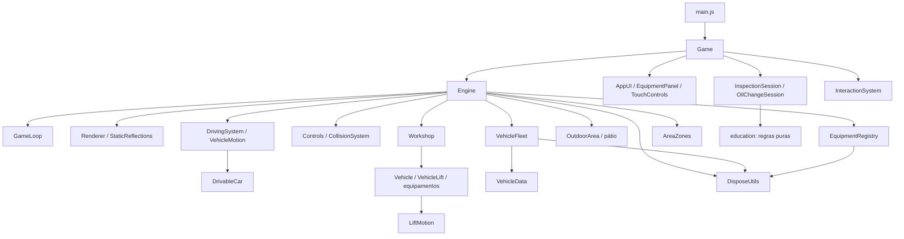

# Arquitetura do simulador

ES Modules com composição e regras educativas separadas do 3D. A refatoração conserva as interfaces públicas usadas pelas sessões e pela página de comparação.

## Dependências

## Responsabilidades

| Módulo | Responsabilidade |
| --- | --- |
| Game | `createGame(root)` retorna start/dispose; possui estado, percursos, sessões e callbacks da interface. |
| Engine | Fachada de cena, câmera, mundo e controles; mantém start/loadVehicles/applySettings/focus/dispose. |
| GameLoop | Único setAnimationLoop; delta em segundos limitado a 0,05; atualização antes da renderização; start/stop idempotentes. |
| Renderer | Cria/configura WebGLRenderer; DPR 1/1,5/2 limitado ao aparelho. |
| StaticReflections | Captura única do cenário em média/alta; possui e descarta o render target. |
| Workshop e construtores | Geometria, luzes, materiais, implantação, batching e instanciamento. |
| OutdoorArea | Pista, zebras, área verde, cerca, horizonte e carro de testes; devolve `root`, `backdrop`, luzes próprias e `layout`. |
| AreaZones | Regras puras de área (`inside`/`outside`/`both`) a partir da câmera e do foco, com faixa do portão. |
| VehicleMotion | Estado veicular sem Three.js: curva de potência progressiva (teto de 150 km/h), ré, arrasto, aderência, freio de mão e derrapagem. |
| DrivingSystem | Entrada/saída do carro, câmera de perseguição, colisão, marcas de pneu e HUD de velocidade. |
| Controls | Primeira pessoa, pointer lock, teclado/mouse, velocidade e pausa por perda de foco. |
| CollisionSystem | Círculo horizontal contra AABB, subdivisão e deslizamento; não simula física veicular. |
| LiftMotion | Estado temporal sem DOM/Three.js; quatro segundos com interpolação quintic. |
| VehicleLift | Adapta estado a grupo 3D, colisões, destaque e travas; campos públicos anteriores delegam ao estado. |
| VehicleData / VehicleFleet | Cadastro/validação e carregamento visual; Draco/KTX2, LOD e recursos próprios. |
| EquipmentRegistry | IDs únicos, contrato de interação, GLB opcional e fallback. |
| InteractionSystem | Seleção por distância, direção e oclusão; preserva ações específicas dos adaptadores. |
| education | Progressão, ferramentas, pré-requisitos e conclusão independentes da renderização. |
| systems/*Session | Regras, raycasts, animação, câmera orbital e apresentação de cada prática, atualizadas pelo motor. |
| ProgressSystem / AudioSystem | Persistência local com fallback em memória e feedback sonoro opcional. |
| DisposeUtils | Libera geometria, materiais, texturas, shadow maps e buffers de instâncias uma vez por conjunto. |

## Inicialização e atualização

index.html importa main.js, que cria Game. start carrega quatro JSON em paralelo, constrói Engine, carrega frota somente se configurada, registra equipamentos/estações e cria sessões/eventos. Então inicia o loop e abre a tela inicial. Falhas técnicas vão ao console e à tela de recuperação; equipamento GLB opcional e reflexos têm fallback não crítico.

Ordem por frame: controles, veículo didático, elevadores, objetos registrados, sessões, seleção/HUD e renderização. Página oculta não atualiza/renderiza; o tempo é rebaseado sem acumular salto. Repetir start não instala callbacks concorrentes. Comparação usa a mesma fachada e OrbitControls.

Estados: loading, home, playing, paused, panel, help, settings, activities, assembly e oil-change. Pausa interrompe movimento e libera pointer lock; retomar exige gesto do usuário. Regras educativas permanecem nos modelos, sem dependência do renderer.

## Pátio, pista e recorte por área

`Engine` monta o `Workshop` (dividido em `shell`, `interior` e `exterior`) e o `OutdoorArea` (pátio em `root` e horizonte em `backdrop`). `AreaZones.resolveWorkshopArea` combina a posição da câmera com o foco — a câmera em primeira pessoa ou o carro quando dirigindo — e devolve `inside`, `outside` ou `both`; `both` vale na faixa do portão para permitir atravessá-lo sem cortes bruscos. `Engine.applyArea` alterna visibilidade de interior/exterior/pátio, frota e conjunto de luzes (interna versus solar), enquanto `applyAtmosphere` troca fundo, neblina e `camera.far` conforme a câmera esteja dentro ou fora: no pátio usa `FogExp2` densa (0,03) com céu da mesma cor, criando a visibilidade curta estilo Silent Hill; no interior a densidade cai para 0,012, uma bruma leve que não atrapalha as práticas. Ambos os recortes são pré-compilados no `start` para evitar engasgo na primeira troca.

`DrivingSystem` usa `VehicleMotion` (posição, velocidade lateral/longitudinal, esterço). A potência cai com o quadrado da velocidade, dando a progressão de marchas de um arcade: 0 a 100 km/h leva cerca de 7,7 s e o teto é 150 km/h. `DrivableCar` reaproveita o veículo didático da oficina (`Vehicle` em modo `displayOnly`), reorientado para +Z e com as rodas separadas antes do batching, para girar e esterçar sem perder os lotes do restante da carroceria. A entrada exige proximidade; dirigindo, os controles de caminhada são suspensos, a câmera vira perseguição e a caixa do jogador é desativada. A saída procura um ponto livre ao lado do carro e restaura a câmera em primeira pessoa. A colisão usa círculo contra os AABBs do pátio com raio maior. `SkidMarks` recicla instâncias para não crescer em memória. Posição e rumo iniciais vêm de `workshop.json.driving`; o layout da pista e a vegetação são derivados das dimensões da oficina.

**Danos e reparo:** a cada quadro, o deslocamento é testado por uma sonda descartável no `CollisionSystem`; se o carro for bloqueado com velocidade acima de 25 km/h, `DrivingSystem.crash` acumula dano (0 a 1) e `DrivableCar.addDent` posiciona um amassado do pool de 18 esferas achatadas contra o painel atingido, na cor escurecida da pintura, com tremor de câmera e `VehicleMotion.maxSpeed` reduzido a 55 km/h quando o dano é grave. Os amassados persistem após sair do carro. A pé e perto do veículo, **E** abre o `RepairSession` (estado `repair`): a câmera enquadra o painel danificado e o `BodyRepairActivity` conduz quatro etapas manuais — soltar os fixadores, arrastar o martelo pelo mapa de amassados (cada acerto esconde um amassado), escolher e instalar a peça certa para a zona detectada (`front`, `rear` ou `side`) e apertar os parafusos na sequência 1·2·3·4. Ao concluir, `DrivingSystem.repair` zera o dano, restaura o teto de velocidade e mantém a peça nova; sair no meio restaura o estado visual anterior do carro.

## Propriedade e encerramento

Game aborta listeners globais, remove handlers de toque e encerra sessões antes do motor. Sessões removem eventos e controladores orbitais; óleo descarta rigs e libera travas. Engine para o loop, invalida o registro, encerra frota/reflexos/controles, descarta recursos da cena e remove o canvas. O encerramento de Game/Engine/frota é idempotente.

A cena possui os recursos GPU do registro. A frota remove seu grupo antes do descarte da cena; preserva a textura de sombra durante descarte individual e a libera no encerramento. DisposeUtils aceita Set compartilhado entre raízes e exclusões de texturas. Não fecha ImageBitmaps indiscriminadamente porque a propriedade pode ser compartilhada por loaders. GLBs de equipamento concluídos após encerramento são liberados sem serem anexados.

Não há cache global adicional: compartilhamento entre instâncias exigiria regras de propriedade ainda não necessárias. Materiais dos construtores podem ser compartilhados na mesma aplicação. IDs da UI continuam globais; múltiplas aplicações simultâneas no mesmo DOM não são suportadas.

## Configuração e limites

workshop.json define implantação e câmeras; equipment.json, activities.json e assembly.json definem conteúdo. Dimensões locais permanecem nos construtores: centralizar cada coordenada aumentaria acoplamento. VehicleData descreve modelos visuais; perfis de óleo são adaptações educativas independentes de dimensões do fabricante.

Sombras WebGL continuam desativadas em todas as qualidades, como antes desta etapa; sombras de contato e sonda estática permanecem. Geometria, materiais, posições e luzes não foram redesenhados. Não há medição de FPS no hardware real nem justificativa para otimizações especulativas.

Não foram introduzidos EventBus, hierarquia de atividades, TypeScript ou framework. InspectionSession/OilChangeSession continuam coordenadores de suas práticas; as regras já estão separadas em education. Consulte o README para extensão e o [relatório](refatoracao.md) para backup, evidências e limitações.

## Modo de inspeção

Na troca manual, `ManualWheelSession` compõe regras puras (`WheelMaintenanceActivity`) e arraste por raio/plano (`ConstrainedPartDrag`). A sessão controla captura, poses, animações e restauração, sem motor físico nem loop próprio; o seletor normal é suspenso durante o gesto. A roda e os fixadores são emprestados, não clonados. Veja [roda-manual.md](roda-manual.md).

Game abre InspectionSession diretamente ao clicar no carro. Engine mantém a oficina pausada e usa seu loop/renderer em uma janela modal: o mesmo canvas é movido para o painel; uma captura estática da oficina forma o fundo desfocado. InspectionPartSelection identifica hover/clique; VehicleParts fornece informações e preserva a identificação em lotes/instâncias. InspectionWorkbench adapta as regras de AssemblyActivity/ServiceActivity às ações dentro da janela, restaurando alterações transitórias ao encerrar. O veículo é emprestado sem clonagem; GLBs detalhados opcionais continuam sob demanda. Configuração, responsabilidades e evidências em [inspecao.md](inspecao.md).
